

  
  
  
  
  

  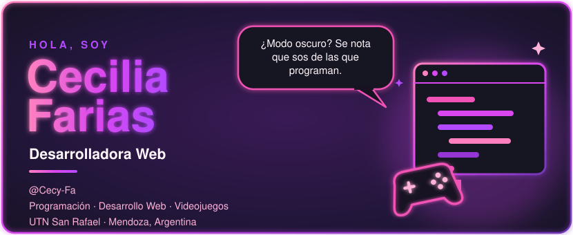

  <a href="#trabajos-realizados">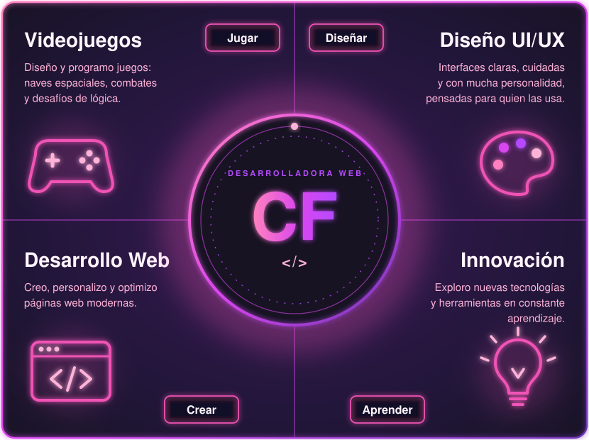</a>

---

### ¡Hola! 👋 Bienvenido/a a mi perfil de GitHub

Soy **estudiante de Programación y Desarrollo Web**, apasionada por la tecnología, el diseño y la creación de experiencias digitales.

Me interesa especialmente el **diseño y desarrollo de videojuegos**, así como la **creación, personalización, modificación y optimización de páginas web**. Disfruto transformar ideas en proyectos interactivos, combinando creatividad, diseño visual y programación.

Me encuentro en constante aprendizaje, explorando nuevas herramientas y tecnologías para desarrollar soluciones innovadoras, funcionales y visualmente atractivas.

#### 🚀 Mis principales intereses

- 🎮 Diseño y desarrollo de videojuegos
- 🎨 Diseño UI/UX y creatividad digital
- 💻 Desarrollo y diseño de páginas web
- 🛠️ Modificación, mantenimiento y optimización de sitios web
- 💡 Exploración de nuevas tecnologías y herramientas

> 💜 **Mi objetivo:** seguir creciendo como desarrolladora, adquirir nuevos conocimientos y convertir ideas creativas en experiencias digitales únicas.

---

### Trabajos realizados

Proyectos de mis **2 años de cursado en la UTN – Facultad Regional San Rafael**, desarrollados en equipo con **Escuadrón Lobo** 🐺.
Los marcados con  tienen el diseño visual hecho por mí.

<b>✦ Cuarto trimestre</b>

 

<table>
<tr>
<td width="50%" valign="top">
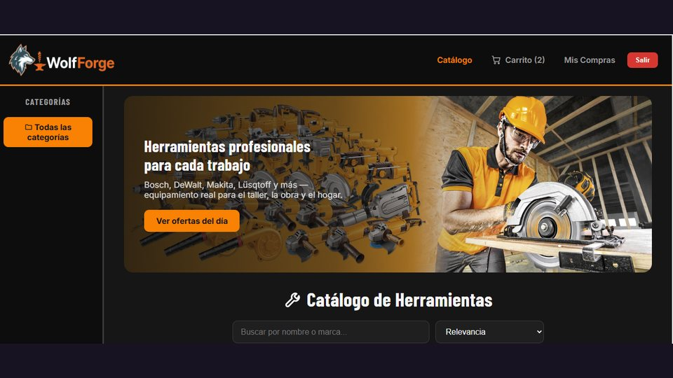
<h4>WolfForge · proyecto integrador</h4>
Tienda online de herramientas: catálogo con filtros, carrito, pagos con Mercado Pago, roles de usuario y panel de administración. 
<code>Java 21</code> <code>Spring Boot</code> <code>Spring Security · JWT</code> <code>PostgreSQL</code> <code>Vue</code> <code>Docker</code> 
<a href="https://github.com/Cecy-Fa/[REPO-WOLFFORGE]">Ver código →</a>
</td>
<td width="50%" valign="top">
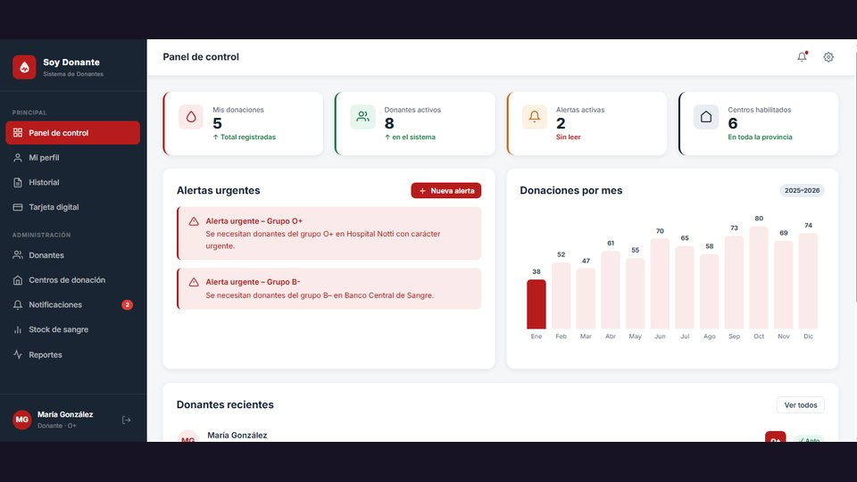
<h4>Soy Donante </h4>
App de gestión de donantes de sangre para Mendoza: panel de control, alertas urgentes, tarjeta digital del donante, historial y reportes. 
<code>HTML</code> <code>CSS</code> <code>JavaScript</code> 
<a href="https://github.com/Cecy-Fa/[REPO-SOY-DONANTE]">Ver código →</a>
</td>
</tr>
<tr>
<td width="50%" valign="top">
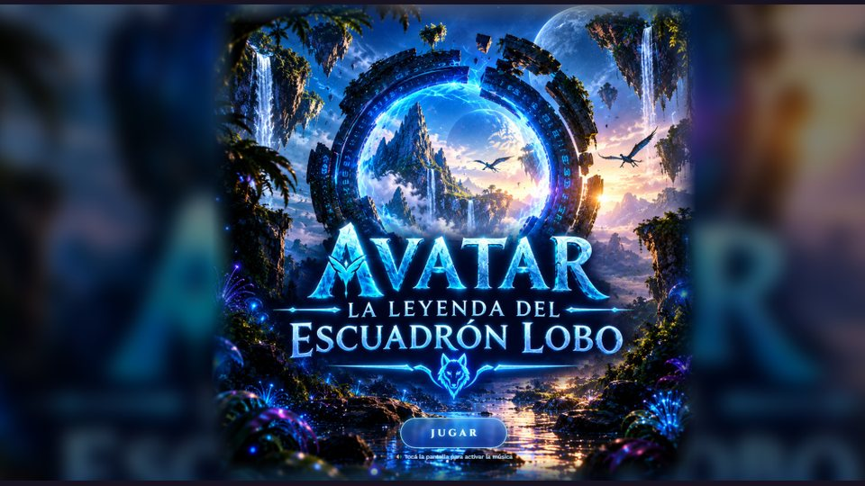
<h4>Avatar: La Leyenda del Escuadrón Lobo </h4>
Juego web de combate con selección de personajes, generador de personajes y escenarios ilustrados. 
<code>HTML</code> <code>CSS</code> <code>JavaScript</code> 
<a href="https://github.com/Cecy-Fa/[REPO-AVATAR]">Ver código →</a>
</td>
<td width="50%" valign="top">
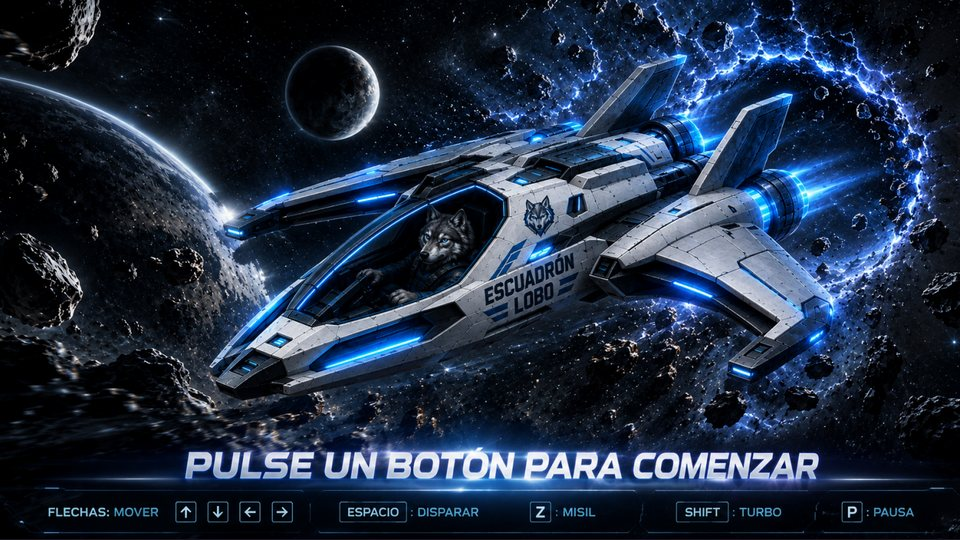
<h4>Galaxis · juego de naves </h4>
Videojuego espacial 2D con HUD, flota enemiga, radar, misiles, escudo, niveles y puntajes. 
<code>Python</code> <code>Pygame</code> 
<a href="https://github.com/Cecy-Fa/[REPO-GALAXIS]">Ver código →</a>
</td>
</tr>
<tr>
<td width="50%" valign="top">
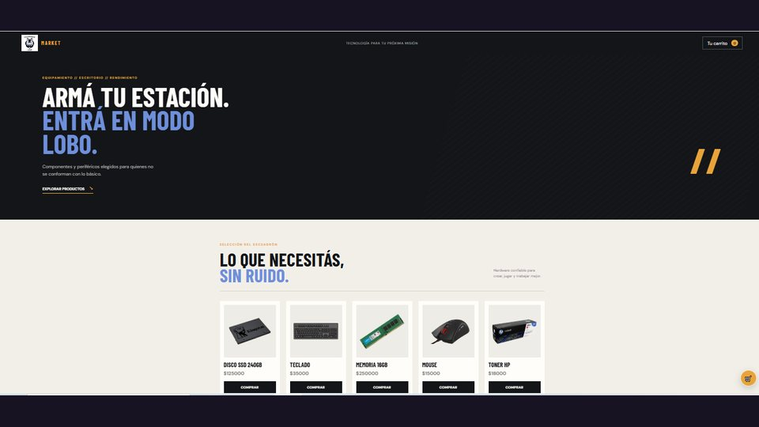
<h4>Comercio electrónico</h4>
Tienda online con portada destacada y catálogo de productos. 
<a href="https://github.com/Cecy-Fa/[REPO-COMERCIO]">Ver código →</a>
</td>
<td width="50%" valign="top">
</td>
</tr>
</table>

<b>✦ Tercer trimestre</b>

 

<table>
<tr>
<td width="50%" valign="top">
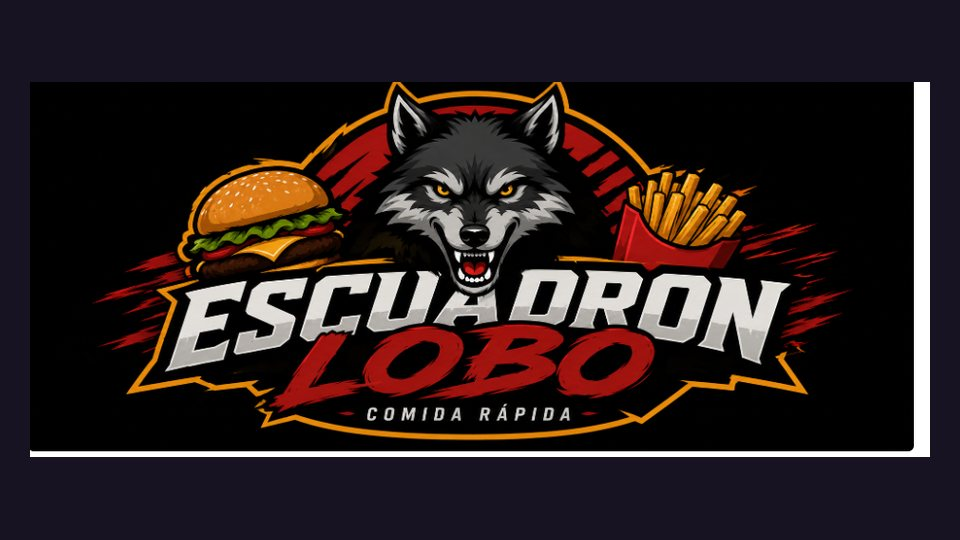
<h4>Restaurante Escuadrón Lobo</h4>
Sistema de comida rápida con roles (administración, mozo, cocinero y cliente): menú, pedidos, stock e informes de ventas. 
<code>Python</code> <code>PostgreSQL</code> <code>psycopg</code> <code>pgAdmin</code> 
<a href="https://github.com/Cecy-Fa/[REPO-RESTAURANTE-LOBO]">Ver código →</a>
</td>
<td width="50%" valign="top">
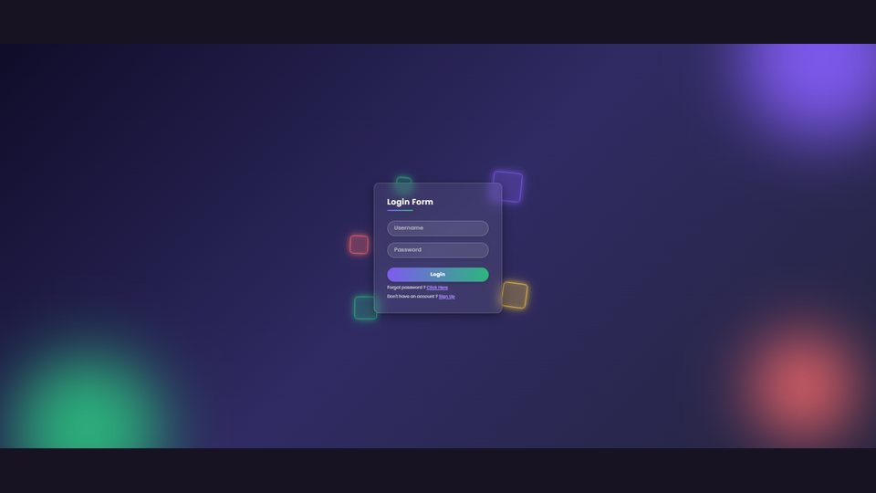
<h4>Login </h4>
Formulario de inicio de sesión con efecto vidrio y fondo animado de luces. 
<code>HTML</code> <code>CSS</code> 
<a href="https://github.com/Cecy-Fa/[REPO-LOGIN]">Ver código →</a>
</td>
</tr>
<tr>
<td width="50%" valign="top">
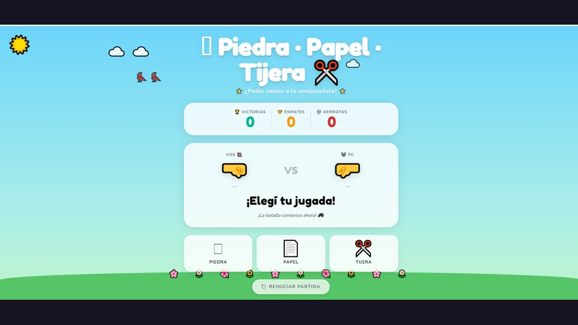
<h4>Piedra · Papel · Tijera </h4>
Juego contra la computadora con marcador de victorias, empates y derrotas. 
<code>HTML</code> <code>CSS</code> <code>JavaScript</code> 
<a href="https://github.com/Cecy-Fa/[REPO-PPT]">Ver código →</a>
</td>
<td width="50%" valign="top">
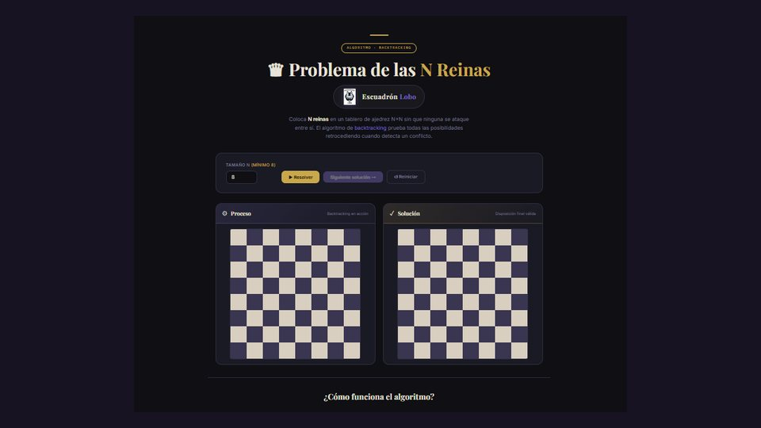
<h4>Problema de las N Reinas </h4>
Visualización del algoritmo de backtracking paso a paso, con proceso y solución. 
<code>HTML</code> <code>CSS</code> <code>JavaScript</code> 
<a href="https://github.com/Cecy-Fa/[REPO-N-REINAS]">Ver código →</a>
</td>
</tr>
<tr>
<td width="50%" valign="top">
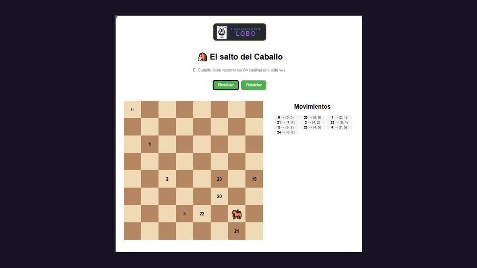
<h4>El salto del Caballo</h4>
Recorrido del caballo por las 64 casillas del tablero, con registro de movimientos. 
<code>HTML</code> <code>CSS</code> <code>JavaScript</code> 
<a href="https://github.com/Cecy-Fa/[REPO-CABALLO]">Ver código →</a>
</td>
<td width="50%" valign="top">
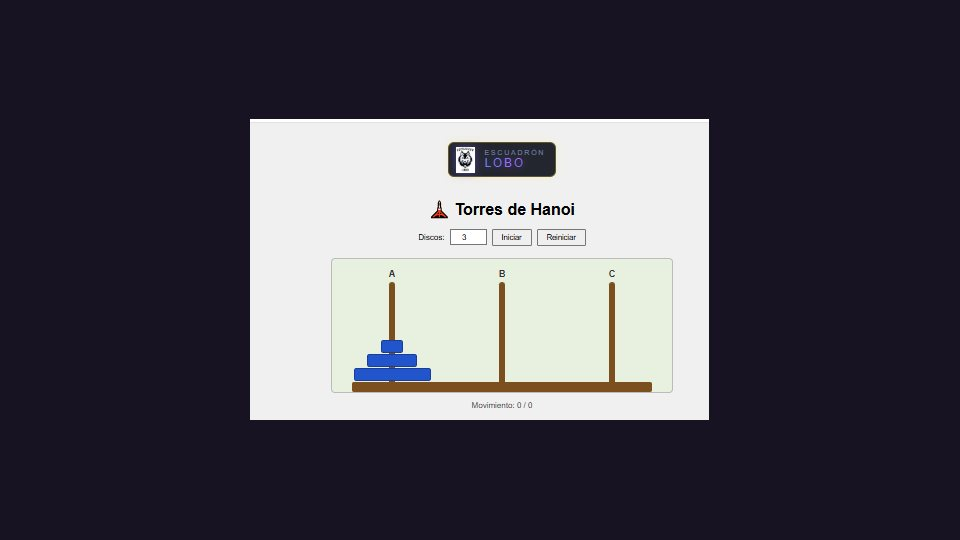
<h4>Torres de Hanoi</h4>
Resolución animada del clásico problema recursivo, con cantidad de discos configurable. 
<code>HTML</code> <code>CSS</code> <code>JavaScript</code> 
<a href="https://github.com/Cecy-Fa/[REPO-HANOI]">Ver código →</a>
</td>
</tr>
</table>

<b>✦ Segundo trimestre</b>

 

<table>
<tr>
<td width="50%" valign="top">

<h4>Sistema de Gestión de Restaurante</h4>
Primer sistema de gestión del equipo, desarrollado en Java. 
<code>Java</code> <code>IntelliJ IDEA</code> 
<a href="https://github.com/Cecy-Fa/[REPO-GESTION-RESTAURANTE]">Ver código →</a>
</td>
<td width="50%" valign="top">
</td>
</tr>
</table>

---

### Tecnologías

  
  
  
  
  
  
  
  
  
  
  
  
  
  
  

---
### Actividad

  <picture>
    <source media="(prefers-color-scheme: dark)" srcset="https://raw.githubusercontent.com/Cecy-Fa/Cecy-Fa/output/snake-dark.svg" />
    <source media="(prefers-color-scheme: light)" srcset="https://raw.githubusercontent.com/Cecy-Fa/Cecy-Fa/output/snake-light.svg" />
    
  </picture>

---
### Estadísticas

  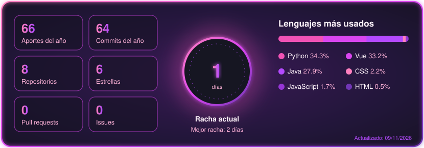

---

  <b><i>«Donde la creatividad se encuentra con el código, nacen nuevas experiencias.»</i></b> 💜

